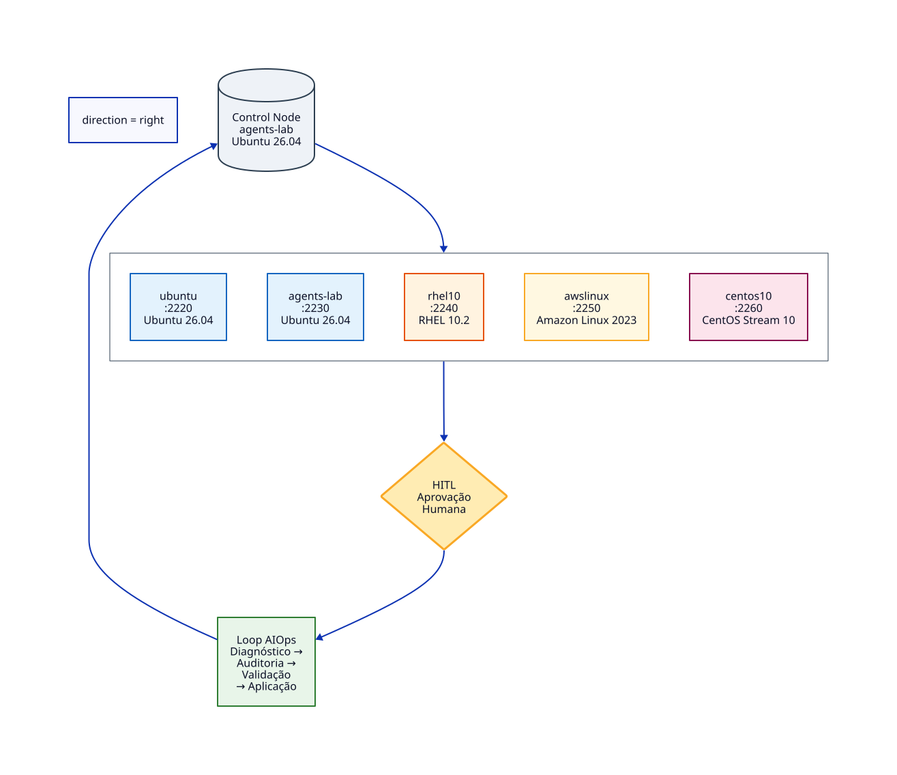
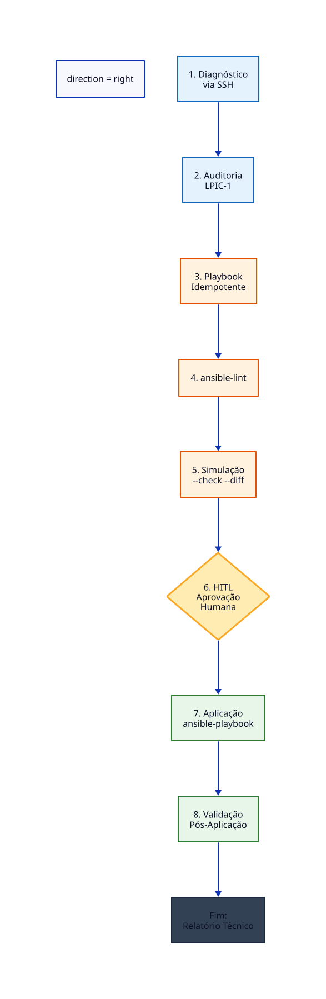
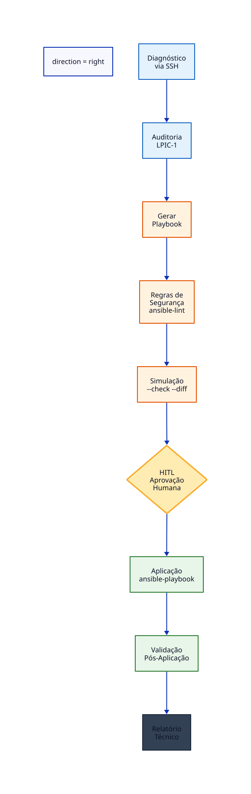

# Guia Completo — Ansible no Projeto AIOps Control Node

Este documento explica, em detalhes conceituais e práticos, como o **Ansible** é utilizado no projeto `aiops-control-node`, sua importância no contexto de SRE/DevOps, o fluxo de trabalho obrigatório e exemplos práticos para os hosts gerenciados (`centos10`, `amazonlinux-2023`, `rhel10`, `ubuntu`, `agents-lab`).

---

## Sumário

1. [O que é o Ansible?](#1-o-que-é-o-ansible)
2. [Por que Ansible neste projeto?](#2-por-que-ansible-neste-projeto)
3. [Arquitetura e componentes](#3-arquitetura-e-componentes)
4. [Fluxo de trabalho obrigatório](#4-fluxo-de-trabalho-obrigatório)
5. [Passo a passo: do zero ao primeiro playbook](#5-passo-a-passo-do-zero-ao-primeiro-playbook)
6. [Exemplos práticos por host](#6-exemplos-práticos-por-host)
7. [Ansible Vault: gerenciamento de segredos](#7-ansible-vault-gerenciamento-de-segredos)
8. [Validação antes de aplicar](#8-validação-antes-de-aplicar)
9. [Diagramas e esquemas](#9-diagramas-e-esquemas)
10. [Importância no contexto AIOps/SRE](#10-importância-no-contexto-aiops-sre)
11. [Checklist de boas práticas](#11-checklist-de-boas-práticas)

---

## 1. O que é o Ansible?

O **Ansible** é uma ferramenta de automação de TI open source (Red Hat) para gerenciamento de configuração, implantação de aplicações e orquestração de tarefas. Seus pilares:

| Pilar | Descrição |
|-------|-----------|
| **Agentless** | Não precisa instalar agente nos hosts remotos. Apenas requer SSH e Python. |
| **Declarativo** | Você descreve o *estado desejado* (ex: "o pacote nginx deve estar instalado e iniciado"), não os passos imperativos. |
| **Idempotente** | Executar a mesma tarefa múltiplas vezes produz o mesmo resultado, sem efeitos colaterais após a primeira aplicação. |
| **YAML** | Playbooks e inventários são escritos em YAML, legível por humanos e fácil de versionar em Git. |

---

## 2. Por que Ansible neste projeto?

O `aiops-control-node` gerencia servidores Enterprise Linux distribuídos. Sem automação, cada mudança exigiria acesso manual via SSH a cada host, propenso a erros e sem rastreabilidade. O Ansible resolve:

| Problema manual | Solução com Ansible |
|-----------------|---------------------|
| Alterar `/etc/hostname` em 5 hosts um por um | Um playbook altera todos de forma consistente |
| Esquecer se um serviço foi iniciado em um host | Idempotência garante o estado desejado |
| Sem registro do que foi alterado | Playbooks versionados em Git servem como documentação executável |
| Risco de comandos destrutivos acidentais | `--check --diff` simula antes de aplicar |
| Senhas e chaves expostas | `Ansible Vault` criptografa segredos |

---

## 3. Arquitetura e componentes

### Diagrama de arquitetura (D2 / SVG)



### Componentes principais

| Componente | Função no projeto |
|------------|-------------------|
| **Control Node** | Ubuntu 26.04 onde o Ansible está instalado e os playbooks são executados |
| **Managed Nodes** | Os 5 hosts Linux gerenciados via SSH |
| **Inventory** | Arquivo `ansible/inventory.ini` que lista hosts, grupos, portas e usuários |
| **Playbook** | Arquivo YAML com uma lista de plays e tarefas a serem executadas |
| **Task** | Unidade mínima de trabalho (ex: instalar pacote, copiar arquivo, iniciar serviço) |
| **Module** | Implementação de uma tarefa (ex: `ansible.builtin.package`, `ansible.builtin.service`, `ansible.builtin.lineinfile`) |
| **Handler** | Tarefa executada apenas quando notificada por outra tarefa (ex: reiniciar sshd após mudar `sshd_config`) |
| **Role** | Estrutura de diretórios que organiza playbooks, variáveis, templates e tarefas para reutilização |
| **Fact** | Informações coletadas automaticamente sobre o host remoto (versão do SO, memória, interfaces de rede) |

---

## 4. Fluxo de trabalho obrigatório

Toda alteração persistente na infraestrutura segue este fluxo, conforme definido no `AGENTS.md`:

### Fluxo de trabalho obrigatório (D2 / SVG)



**Regra de ouro:** Nunca pule a etapa de simulação (`--check --diff`) nem a aprovação humana (HITL).

---

## 5. Passo a passo: do zero ao primeiro playbook

### 5.1 Instalar o Ansible no Control Node

```bash
# No Ubuntu 26.04 (Control Node)
sudo apt update
sudo apt install -y ansible ansible-lint sshpass
ansible --version
```

> Nota: Em Ubuntu 26.04 (PEP 668), use `sudo apt install -y ansible-lint` em vez de `pip3 install` para evitar conflitos com o gerenciador de pacotes externo.

### 5.2 Configurar o inventário

O arquivo `ansible/inventory.ini` já existe no projeto. Exemplo de referência:

```ini
[centos]
centos10 ansible_host=127.0.0.1 ansible_port=2260 ansible_user=ansible-ops ansible_ssh_private_key_file=~/.ssh/id_linux-mcp-server

[amazonlinux]
awslinux ansible_host=127.0.0.1 ansible_port=2250 ansible_user=ansible-ops ansible_ssh_private_key_file=~/.ssh/id_linux-mcp-server

[rhel]
rhel10 ansible_host=127.0.0.1 ansible_port=2240 ansible_user=ansible-ops ansible_ssh_private_key_file=~/.ssh/id_linux-mcp-server

[ubuntu_nodes]
ubuntu ansible_host=127.0.0.1 ansible_port=2220 ansible_user=ansible-ops ansible_ssh_private_key_file=~/.ssh/id_linux-mcp-server
agents-lab ansible_host=127.0.0.1 ansible_port=2230 ansible_user=ansible-ops ansible_ssh_private_key_file=~/.ssh/id_linux-mcp-server

[linux:children]
centos
amazonlinux
rhel
ubuntu_nodes

[linux:vars]
ansible_python_interpreter=/usr/bin/python3
ansible_ssh_common_args='-o IdentitiesOnly=yes -o StrictHostKeyChecking=accept-new -o ConnectTimeout=5 -o ServerAliveInterval=30 -o ServerAliveCountMax=3'

[ubuntu_nodes:vars]
ansible_become_prompt=[sudo: authenticate] Password:
```

### 5.3 Testar conectividade

```bash
# Teste com todos os hosts
ansible all -i ansible/inventory.ini -m ping

# Teste apenas um grupo
ansible centos -i ansible/inventory.ini -m ping

# Teste com comando arbitrário
ansible all -i ansible/inventory.ini -a "hostnamectl --static"
```

### 5.4 Playbooks existentes no projeto

O repositório já contém os seguintes playbooks em `ansible/playbooks/`:

| Playbook | Propósito |
|----------|-----------|
| `bootstrap-service-user.yml` | Provisiona e restringe o usuário de serviço `ansible-ops` com sudo restrito |
| `diagnostico-somente-leitura.yml` | Coleta somente-leitura (hostname, SO, serviços falhados, disco, memória) |
| `hostname-correction.yml` | Corrige hostnames usando `ansible/vars/hostnames.yml` |
| `ssh-hardening.yml` | Hardening SSH (`PasswordAuthentication no`) e máscara de `getty@tty1.service` |

### 5.5 Criar o primeiro playbook

Exemplo: garantir que o serviço SSH esteja iniciado e habilitado em todos os hosts Linux. Suporta tanto Debian/Ubuntu (`ssh`) quanto RedHat (`sshd`):

```yaml
---
- name: Garantir serviço SSH ativo e habilitado
  hosts: linux
  become: true
  become_method: ansible.builtin.sudo
  vars:
    ssh_service_name: "{{ 'ssh' if ansible_os_family == 'Debian' else 'sshd' }}"
  tasks:
    - name: Garantir que o serviço SSH esteja iniciado e habilitado
      ansible.builtin.service:
        name: "{{ ssh_service_name }}"
        state: started
        enabled: yes

    - name: Aplicar hardening do sshd_config
      ansible.builtin.lineinfile:
        path: /etc/ssh/sshd_config.d/99-hardening.conf
        regexp: '^#?PermitRootLogin'
        line: 'PermitRootLogin no'
        state: present
        mode: '0644'
      notify: reiniciar ssh

  handlers:
    - name: reiniciar ssh
      ansible.builtin.service:
        name: "{{ ssh_service_name }}"
        state: restarted
```

Salve como `ansible/playbooks/hardening-sshd.yml`.

### 5.6 Validar com ansible-lint

```bash
ansible-lint ansible/playbooks/hardening-sshd.yml
```

Se não houver erros, prossiga. Caso houver, corrija o YAML ou as regras antes de continuar.

### 5.7 Simular aplicação (dry-run)

```bash
ansible-playbook -i ansible/inventory.ini --check --diff \
  ansible/playbooks/hardening-sshd.yml
```

O `--check` não aplica mudanças. O `--diff` mostra o que seria alterado em cada arquivo.

### 5.8 Solicitar aprovação (HITL)

Apresente ao operador:

```
## 🛑 HITL — Pedido de Aprovação

### Ação solicitada
Aplicar playbook hardening-sshd.yml em todos os hosts Linux.

### Host(s) alvo
ubuntu, agents-lab, rhel10, awslinux, centos10

### Impacto esperado
- sshd_config será alterado (PermitRootLogin no)
- Serviço ssh/sshd será reiniciado se a configuração mudar
- Breve interrupção de SSH durante o restart (reconectar imediatamente)

### Plano de reversão
Restaurar /etc/ssh/sshd_config do backup e reiniciar sshd.

### Janela de execução
Imediato, com operador disponível para reconectar via SSH.

### Confiança do agente
Alta
```

O operador responde `aprovar`, `rejeitar`, `ajustar` ou `adiar`.

### 5.9 Aplicar (somente após aprovação)

```bash
ansible-playbook -i ansible/inventory.ini \
  --private-key ~/.ssh/id_linux-mcp-server \
  --ask-become-pass \
  ansible/playbooks/hardening-sshd.yml
```

### 5.10 Validar pós-aplicação

```bash
# Verificar se o serviço SSH está rodando em todos os hosts
ansible all -i ansible/inventory.ini -a "systemctl is-active ssh"
ansible all -i ansible/inventory.ini -a "systemctl is-active sshd"

# Verificar se a configuração foi aplicada
ansible all -i ansible/inventory.ini -a "grep '^PermitRootLogin' /etc/ssh/sshd_config.d/99-hardening.conf"
```

---

## 6. Exemplos práticos por host

### 6.1 Provisionar usuário de serviço ansible-ops

```yaml
---
- name: Provisionar e restringir usuario de servico ansible-ops
  hosts: all
  become: true
  vars:
    service_user: ansible-ops
    ssh_pub_key_path: "{{ lookup('env', 'HOME') }}/.ssh/id_linux-mcp-server.pub"
  tasks:
    - name: Criar usuario de servico dedicado
      ansible.builtin.user:
        name: "{{ service_user }}"
        comment: "AIOps Automation Service Account"
        shell: /bin/bash
        create_home: true
        state: present

    - name: Configurar chave SSH autorizada para o usuario de servico
      ansible.posix.authorized_key:
        user: "{{ service_user }}"
        path: "/home/{{ service_user }}/.ssh/authorized_keys"
        state: present
        key: "{{ lookup('file', ssh_pub_key_path) }}"

    - name: Configurar sudo restrito (menor privilegio) e validado com visudo
      ansible.builtin.copy:
        dest: "/etc/sudoers.d/{{ service_user }}"
        content: |
          # Sudo restrito para automacao Ansible (AIOps Control Node)
          {{ service_user }} ALL=(root) NOPASSWD: /usr/bin/hostnamectl, /bin/sh, /usr/bin/python3
        owner: root
        group: root
        mode: "0440"
        validate: "/usr/sbin/visudo -cf %s"
```

Salve como `ansible/playbooks/bootstrap-service-user.yml`.

### 6.2 Diagnóstico somente-leitura

```yaml
---
- name: Diagnóstico somente-leitura dos hosts gerenciados
  hosts: linux
  gather_facts: false
  become: false
  tasks:
    - name: Coletar hostname atual
      ansible.builtin.command: hostnamectl --static
      register: hostname_info
      changed_when: false

    - name: Coletar versão do SO
      ansible.builtin.command: cat /etc/os-release
      register: os_info
      changed_when: false

    - name: Coletar serviços falhados
      ansible.builtin.command: systemctl --failed --no-pager
      register: failed_services
      changed_when: false
      ignore_errors: true

    - name: Coletar uso de disco
      ansible.builtin.command: df -hT /
      register: disk_info
      changed_when: false

    - name: Coletar uso de memória
      ansible.builtin.command: free -h
      register: memory_info
      changed_when: false

    - name: Reportar diagnóstico consolidado
      ansible.builtin.debug:
        msg: |
          ============================================
          Host: {{ inventory_hostname }}
          ============================================
          Hostname: {{ hostname_info.stdout.strip() }}
          SO: {{ os_info.stdout.splitlines()[0] if os_info.stdout else 'N/A' }}
          Memória: {{ memory_info.stdout.splitlines()[1] if memory_info.stdout else 'N/A' }}
          Disco (/): {{ disk_info.stdout.splitlines()[1] if disk_info.stdout else 'N/A' }}
          Serviços falhados: {{ failed_services.stdout.strip() if failed_services.stdout and failed_services.rc == 0 else 'erro ao coletar ou nenhum' }}
          ============================================
```

Salve como `ansible/playbooks/diagnostico-somente-leitura.yml`.

### 6.3 Corrigir hostname

```yaml
---
- name: Corrigir hostname dos hosts WSL2 gerenciados
  hosts: linux
  become: true
  vars_files:
    - ../vars/hostnames.yml
  tasks:
    - name: Definir hostname desejado por inventário
      ansible.builtin.set_fact:
        desired_hostname: "{{ hostnames[inventory_hostname] | default(inventory_hostname) }}"

    - name: Verificar hostname atual
      ansible.builtin.command: hostnamectl --static
      register: current_hostname
      changed_when: false
      check_mode: false

    - name: Aplicar hostname via hostnamectl (quando diferente)
      ansible.builtin.command: "hostnamectl set-hostname {{ desired_hostname }}"
      when: current_hostname.stdout.strip() != desired_hostname
      changed_when: current_hostname.stdout.strip() != desired_hostname

    - name: Atualizar /etc/hostname (idempotente)
      ansible.builtin.copy:
        content: "{{ desired_hostname }}\n"
        dest: /etc/hostname
        owner: root
        group: root
        mode: '0644'
      when: current_hostname.stdout.strip() != desired_hostname

    - name: Atualizar /etc/wsl.conf com hostname e DNS determinístico
      ansible.builtin.blockinfile:
        path: /etc/wsl.conf
        create: true
        owner: root
        group: root
        mode: '0644'
        block: |
          [network]
          hostname = {{ desired_hostname }}
          generateResolvConf = false
          generateHosts = false
      when: current_hostname.stdout.strip() != desired_hostname

    - name: Verificar hostname atual após ajuste
      ansible.builtin.command: hostnamectl --static
      register: new_hostname
      changed_when: false
      check_mode: false

    - name: Reportar resultado
      ansible.builtin.debug:
        msg: "Hostname {{ inventory_hostname }}: {{ current_hostname.stdout.strip() }} -> {{ new_hostname.stdout.strip() }}"
```

Salve como `ansible/playbooks/hostname-correction.yml`.

### 6.4 Configurar /etc/wsl.conf (hosts WSL2)

```yaml
---
- name: Configurar /etc/wsl.conf para WSL2
  hosts: ubuntu_nodes,centos,rhel,amazonlinux
  become: true
  become_method: ansible.builtin.sudo
  tasks:
    - name: Escrever /etc/wsl.conf
      ansible.builtin.copy:
        content: |
          [boot]
          systemd=true

          [user]
          default=arabelo

          [network]
          hostname = {{ inventory_hostname }}
          generateHosts = false
          generateResolvConf = false
        dest: /etc/wsl.conf
        owner: root
        group: root
        mode: '0644'
```

> Nota: `generateResolvConf = false` garante DNS determinístico e evita sobrescrita automática do `/etc/resolv.conf` pelo WSL2.

### 6.5 Mascarar getty@tty1 em containers WSL2

```yaml
---
- name: Mascarar getty@tty1 em containers WSL2
  hosts: ubuntu,agents-lab,rhel10,centos10
  become: true
  become_method: ansible.builtin.sudo
  tasks:
    - name: Mascarar getty@tty1.service
      ansible.builtin.systemd:
        name: getty@tty1.service
        masked: true
        state: stopped
```

---

## 7. Ansible Vault: gerenciamento de segredos

Nunca armazene senhas, tokens ou chaves privadas em texto claro nos playbooks. Use o **Ansible Vault** para criptografar arquivos de variáveis sensíveis.

### Criar arquivo criptografado

```bash
ansible-vault create ansible/group_vars/linux/vault.yml
```

Conteúdo exemplo (`vault.yml`):

```yaml
vault_ssh_password: "senha-secreta-aqui"
vault_api_token: "token-de-api-confidencial"
```

### Usar no playbook

```yaml
---
- name: Exemplo com vault
  hosts: linux
  become: true
  become_method: ansible.builtin.sudo
  vars_files:
    - ansible/group_vars/linux/vault.yml
  tasks:
    - name: Exibir apenas o nome da variável (não o valor)
      ansible.builtin.debug:
        msg: "Token configurado (valor oculto por segurança)"
      no_log: true
```

### Executar playbook com vault

```bash
ansible-playbook -i ansible/inventory.ini \
  --ask-vault-pass \
  ansible/playbooks/meu-playbook.yml
```

Ou armazene a senha do vault em um arquivo de senha:

```bash
echo "senha-do-vault" > ~/.ansible_vault_pass
chmod 600 ~/.ansible_vault_pass

ansible-playbook -i ansible/inventory.ini \
  --vault-password-file ~/.ansible_vault_pass \
  ansible/playbooks/meu-playbook.yml
```

---

## 8. Validação antes de aplicar

### 8.1 ansible-lint

```bash
# Validar um playbook
ansible-lint ansible/playbooks/meu-playbook.yml

# Validar todos os playbooks
ansible-lint ansible/playbooks/
```

### 8.2 --check --diff (simulação)

```bash
ansible-playbook -i ansible/inventory.ini \
  --check --diff \
  ansible/playbooks/meu-playbook.yml
```

- `--check`: não faz mudanças reais
- `--diff`: mostra as diferenças que seriam aplicadas em arquivos

---

## 9. Diagramas e esquemas

### Fluxo de decisão (D2 / SVG)



### Camadas de segurança (D2 / SVG)


### Hierarquia de arquivos do projeto

```
aiops-control-node/
├── AGENTS.md                    # Papel e guardrails do agente
├── MEMORY.md                    # Memória do projeto (estado e handoff)
├── README.md                    # Visão geral do projeto
├── docs/
│   ├── ANSIBLE-GUIDE.md         # Este documento
│   ├── EMERGENCY-STOP.md        # Procedimento de parada de emergência
│   └── IA-BEST-PRACTICES.md     # Melhores práticas para IA em infraestrutura
├── ansible/
│   ├── inventory.ini            # Inventário de hosts
│   ├── vars/
│   │   └── hostnames.yml        # Hostnames desejados por host
│   └── playbooks/
│       ├── bootstrap-service-user.yml
│       ├── diagnostico-somente-leitura.yml
│       ├── hostname-correction.yml
│       └── ssh-hardening.yml
└── scripts/
```

---

## 10. Importância no contexto AIOps/SRE

No contexto de **AIOps (Artificial Intelligence for Operations)** e **SRE (Site Reliability Engineering)**, o Ansible desempenha papéis críticos:

| Dimensão | Contribuição do Ansible |
|----------|------------------------|
| **Confiabilidade** | Garante que todos os hosts tenham a mesma configuração, reduzindo "configuração drift" |
| **Escalabilidade** | A mesma tarefa se aplica a 5 ou 500 hosts com o mesmo esforço |
| **Recuperação de desastres** | Playbooks versionados permitem recriar ambientes rapidamente |
| **Segurança** | Hardening consistente (sshd, firewall, usuários) em todos os hosts |
| **Observabilidade** | Coleta de facts do Ansible fornece inventário atualizado do estado dos hosts |
| **Resposta a incidentes** | Playbooks pré-aprovados podem ser aplicados rapidamente após incidente validado |

### O loop AIOps com Ansible

Observação (diagnóstico via SSH)
        │
        ▼
Detecção de anomalia (auditoria LPIC-1 + métricas)
        │
        ▼
Decisão (gerar playbook idempotente)
        │
        ▼
Validação (ansible-lint + --check --diff + HITL)
        │
        ▼
Execução (ansible-playbook aplicação)
        │
        ▼
Verificação (pós-aplicação + critério de validação)
        │
        └──────────────────────► volta à Observação

---

## 11. Checklist de boas práticas

Antes de considerar um playbook pronto para produção:

- [ ] O playbook está em `ansible/playbooks/` com nome descritivo
- [ ] Todas as tarefas são idempotentes (`state: present/absent/started/stopped`)
- [ ] Não há comandos destrutivos (`rm -rf`, `mkfs`, `dd`, `wipefs`, `reboot`)
- [ ] Não há credenciais em texto claro (use Ansible Vault)
- [ ] `ansible-lint` passou sem erros
- [ ] `ansible-playbook --check --diff` executado com sucesso
- [ ] Aprovação via human-in-the-loop (HITL) confirmada pelo operador
- [ ] Plano de reversão documentado
- [ ] Critério de validação definido no relatório técnico

---

## Referências

- [Ansible Documentation](https://docs.ansible.com/)
- [Ansible Best Practices](https://docs.ansible.com/ansible/latest/playbook_guide/playbooks_best_practices.html)
- [Ansible Vault](https://docs.ansible.com/ansible/latest/vault_guide/index.html)
- [Event-Driven Ansible](https://docs.ansible.com/ansible-eda/)
- [Red Hat: AIOps and Ansible Automation Platform](https://redhat.com/en/blog/aiops-and-ansible-automation-platform-where-ai-intelligence-meets-trusted-execution)
