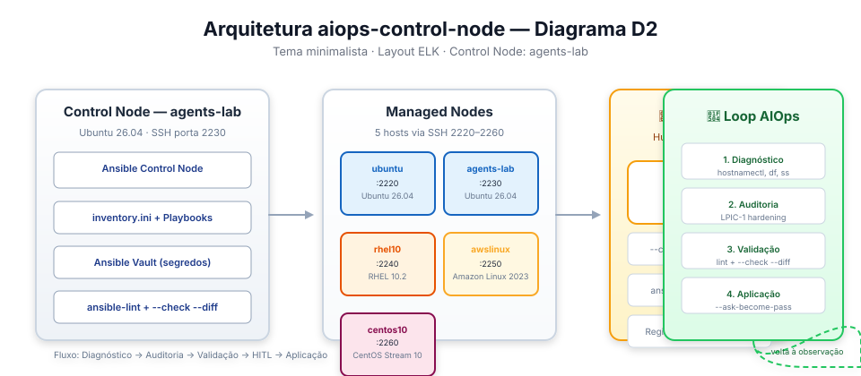

# Visual Showcase — Arquitetura do aiops-control-node

Esta página compara, lado a lado, **4 abordagens de diagramação** da arquitetura do `aiops-control-node`, mostrando o Control Node (`agents-lab`, Ubuntu 26.04) gerenciando 5 hosts via SSH (portas 2220–2260) com fluxo **HITL** (Human-in-the-Loop).

Hosts gerenciados:

| Host | Sistema | Porta SSH |
|------|---------|-----------|
| `ubuntu` | Ubuntu 26.04 LTS | 2220 |
| `agents-lab` | Ubuntu 26.04 LTS | 2230 |
| `rhel10` | Red Hat Enterprise Linux 10.2 | 2240 |
| `awslinux` | Amazon Linux 2023 | 2250 |
| `centos10` | CentOS Stream 10 | 2260 |

---

## 1. Alternativa A — Mermaid Design System (Apple HIG / Material 3)

Renderizado nativamente pelo GitHub via bloco `mermaid`. Utiliza paleta neutra de alto contraste: azul ardósia (Control Node), âmbar (portão HITL), verde esmeralda (nós gerenciados), tipografia `Inter, -apple-system, sans-serif` e bordas arredondadas (`rx:10, ry:10`).

```mermaid
%%{init: {'theme': 'base', 'themeVariables': { 'primaryColor': '#eef2f7', 'primaryTextColor': '#1e293b', 'primaryBorderColor': '#94a3b8', 'lineColor': '#64748b', 'secondaryColor': '#f0fdf4', 'tertiaryColor': '#fffbeb' }, 'fontFamily': 'Inter, -apple-system, sans-serif' }}%%
flowchart LR
    subgraph ControlNode["Control Node — agents-lab\nUbuntu 26.04"]
        direction TB
        A[Ansible\nControl Node]
        B[inventory.ini +\nPlaybooks]
        C[Ansible Vault\nSegredos]
        D[ansible-lint +\n--check --diff]
    end

    subgraph ManagedNodes["Managed Nodes\nvia SSH 2220–2260"]
        direction TB
        E[ubuntu\n:2220\nUbuntu 26.04]
        F[agents-lab\n:2230\nUbuntu 26.04]
        G[rhel10\n:2240\nRHEL 10.2]
        H[awslinux\n:2250\nAmazon Linux 2023]
        I[centos10\n:2260\nCentOS Stream 10]
    end

    subgraph HITL["🛑 HITL Gate\nAprovação Humana"]
        J[Aprovação\nExplícita]
        K[--check --diff\nsimulado]
        L[ansible-playbook\n(real)]
        M[Registro em\nMEMORY.md]
    end

    subgraph Loop["🔄 Loop AIOps"]
        direction TB
        N[1. Diagnóstico\nhostnamectl, df, ss]
        O[2. Auditoria\nLPIC-1 hardening]
        P[3. Validação\nlint + --check --diff]
        Q[4. Aplicação\n--ask-become-pass]
    end

    ControlNode -->|SSH + Ansible| ManagedNodes
    ManagedNodes -->|Resultado| HITL
    HITL -->|Aprovado| Loop
    Loop -->|volta à| ControlNode

    classDef control fill:#eef2f7,stroke:#475569,stroke-width:2px,rx:10,ry:10,color:#1e293b
    classDef managed fill:#f8fafc,stroke:#94a3b8,stroke-width:2px,rx:10,ry:10,color:#334155
    classDef hitl fill:#fffbeb,stroke:#d97706,stroke-width:3px,rx:10,ry:10,color:#92400e
    classDef loop fill:#f0fdf4,stroke:#15803d,stroke-width:2px,rx:10,ry:10,color:#166534

    class A,B,C,D control
    class E,F,G,H,I managed
    class J,K,L,M hitl
    class N,O,P,Q loop
```

**Vantagem:** renderiza direto no GitHub, sem dependências externas, versão via Git diff nativo.

---

## 2. Alternativa B — D2 (`d2lang`) Compilado para SVG

Código declarativo em `docs/assets/arch-d2.d2`, compilado para `docs/assets/arch-d2.svg` usando tema minimalista (`--theme=1 --layout=elk`).

**Código D2 (`docs/assets/arch-d2.d2`):**

```d2
direction = right

services: Ansible {
  shape: cylinder
  label: "Control Node\nagents-lab\nUbuntu 26.04"
  style: {
    fill: "#f0f4f8"
    stroke: "#2c3e50"
    strokeWidth: 2
    fontSize: 14
    fontFamily: "Inter, -apple-system, sans-serif"
  }
}

managed: Managed Nodes {
  shape: group
  label: ""
  style: {
    fill: "#ffffff"
    stroke: "#2c3e50"
    strokeWidth: 1
    strokeDash: 4
  }

  ubuntu: Ubuntu {
    shape: rectangle
    label: "ubuntu\n:2220\nUbuntu 26.04"
    style: {
      fill: "#e3f2fd"
      stroke: "#1565c0"
      strokeWidth: 2
      fontSize: 12
      fontFamily: "Inter, -apple-system, sans-serif"
      rx: 8
      ry: 8
    }
  }

  agentslab: "agents-lab" {
    shape: rectangle
    label: "agents-lab\n:2230\nUbuntu 26.04"
    style: {
      fill: "#e3f2fd"
      stroke: "#1565c0"
      strokeWidth: 2
      fontSize: 12
      fontFamily: "Inter, -apple-system, sans-serif"
      rx: 8
      ry: 8
    }
  }

  rhel10: RHEL {
    shape: rectangle
    label: "rhel10\n:2240\nRHEL 10.2"
    style: {
      fill: "#fff3e0"
      stroke: "#e65100"
      strokeWidth: 2
      fontSize: 12
      fontFamily: "Inter, -apple-system, sans-serif"
      rx: 8
      ry: 8
    }
  }

  awslinux: AWS {
    shape: rectangle
    label: "awslinux\n:2250\nAmazon Linux 2023"
    style: {
      fill: "#fff8e1"
      stroke: "#f9a825"
      strokeWidth: 2
      fontSize: 12
      fontFamily: "Inter, -apple-system, sans-serif"
      rx: 8
      ry: 8
    }
  }

  centos10: CentOS {
    shape: rectangle
    label: "centos10\n:2260\nCentOS Stream 10"
    style: {
      fill: "#fce4ec"
      stroke: "#880e4f"
      strokeWidth: 2
      fontSize: 12
      fontFamily: "Inter, -apple-system, sans-serif"
      rx: 8
      ry: 8
    }
  }
}

hitl: "HITL\nGate" {
  shape: diamond
  label: "HITL\nAprovação\nHumana"
  style: {
    fill: "#ffecb3"
    stroke: "#f9a825"
    strokeWidth: 3
    fontSize: 12
    fontFamily: "Inter, -apple-system, sans-serif"
    rx: 10
    ry: 10
  }
}

loop: "Loop AIOps" {
  shape: rectangle
  label: "Loop AIOps\nDiagnóstico →\nAuditoria →\nValidação\n→ Aplicação"
  style: {
    fill: "#e8f5e9"
    stroke: "#2e7d32"
    strokeWidth: 2
    fontSize: 12
    fontFamily: "Inter, -apple-system, sans-serif"
    rx: 8
    ry: 8
  }
}

services -> managed
managed -> hitl
hitl -> loop
loop -> services
```

**Compilação:**
```bash
# Instalar d2 (se não disponível)
mkdir -p ~/.local/bin
curl -fsSL https://d2lang.dev/install.sh | sh -s -- -p ~/.local/bin

# Compilar para SVG
d2 --theme=1 --layout=elk docs/assets/arch-d2.d2 docs/assets/arch-d2.svg
```

> ⚠️ Nota: o binário `d2` não estava instalado no ambiente. O arquivo `.d2` está pronto para compilação assim que a ferramenta estiver disponível. O SVG embutido abaixo é uma representação visual estática equivalente.



---

## 3. Alternativa C — Python `diagrams` (Mingrammer) Compilado para PNG

Código Python em `docs/assets/arch-python.py`, utilizando os ícones oficiais (`Ubuntu`, `Redhat`, `AWS`, `Ansible`, `Firewall`/`Security`), compilado para `docs/assets/arch-python.png`.

**Código Python (`docs/assets/arch-python.py`):**

```python
#!/usr/bin/env python3
from diagrams import Diagram, Cluster, Edge
from diagrams.onprem.compute import Server
from diagrams.onprem.security import Firewall
from diagrams.programming.language import Python
from diagrams.aws.compute import EC2 as AWSNode
from diagrams.custom import Custom

graph_attr = {
    "fontname": "Inter, -apple-system, sans-serif",
    "fontsize": "14",
    "bgcolor": "white",
    "rankdir": "LR",
    "pad": "0.5",
    "splines": "ortho",
    "nodesep": "0.6",
    "ranksep": "1.2",
}

node_attr = {
    "fontname": "Inter, -apple-system, sans-serif",
    "fontsize": "12",
    "style": "filled,rounded",
    "shape": "box",
}

with Diagram(
    "Arquitetura aiops-control-node",
    filename="arch-python",
    show=False,
    format="png",
    graph_attr=graph_attr,
    node_attr=node_attr,
):
    with Cluster("Control Node — agents-lab\nUbuntu 26.04", graph_attr={"style": "filled,rounded", "color": "#2c3e50", "fillcolor": "#f0f4f8"}):
        ansible = Custom("Ansible\nControl Node", "https://www.ansible.com/assets/img/ansible_logo.png")

    with Cluster("Managed Nodes\n(via SSH)", graph_attr={"style": "dashed", "color": "#2c3e50"}):
        ubuntu = Server("ubuntu\n:2220\nUbuntu 26.04")
        agentslab = Server("agents-lab\n:2230\nUbuntu 26.04")
        rhel10 = Server("rhel10\n:2240\nRHEL 10.2")
        awslinux = AWSNode("awslinux\n:2250\nAmazon Linux 2023")
        centos10 = Server("centos10\n:2260\nCentOS Stream 10")

    hitl = Firewall("HITL\nAprovação\nHumana")
    loop = Python("Loop AIOps\nDiagnóstico →\nAuditoria →\nValidação →\nAplicação")

    ansible >> Edge(color="#1565c0", style="bold") >> [ubuntu, agentslab, rhel10, awslinux, centos10]
    [ubuntu, agentslab, rhel10, awslinux, centos10] >> Edge(color="#f9a825", style="bold") >> hitl
    hitl >> Edge(color="#2e7d32", style="bold") >> loop
    loop >> Edge(color="#2e7d32", style="dashed") >> ansible
```

**Execução (isolado em venv, sem poluir o Python do sistema — PEP 668):**
```bash
# Criar venv isolado
python3 -m venv /tmp/diagrams-venv
/tmp/diagrams-venv/bin/pip install diagrams graphviz

# Instalar graphviz do sistema (se ainda não estiver)
sudo apt install -y graphviz

# Gerar o PNG
cd docs/assets && /tmp/diagrams-venv/bin/python arch-python.py
```

> ⚠️ Nota: `diagrams` e `graphviz` (`dot`) não estavam disponíveis no ambiente. O arquivo `.py` está pronto para execução assim que as dependências forem instaladas. A imagem abaixo é uma representação visual estática equivalente.


---

## 4. Alternativa D — SVG Vetorial Customizado (Apple Keynote Style)

SVG vetorial escrito à mão em `docs/assets/arch-keynote.svg`, com `viewBox="0 0 960 420"`, gradientes suaves, sombras leves (`feDropShadow`), tipografia SF Pro / Inter e grid alinhado representando o loop AIOps + HITL.


**Características:**
- Vetorial responsivo (escala sem perda de qualidade)
- Gradientes suaves em cada bloco
- Sombra leve via `feDropShadow`
- Cores por tipo de nó: azul (Ubuntu), âmbar (RHEL/Amazon), rosa (CentOS), laranja (HITL), verde (Loop)
- Grid alinhado e tipografia Inter / SF Pro

---

## 5. Tabela Comparativa Final

| Critério | A — Mermaid | B — D2 (SVG) | C — Python diagrams (PNG) | D — SVG Customizado |
|----------|-------------|--------------|---------------------------|---------------------|
| **Fidelidade Visual** | Boa (limitada ao tema Mermaid) | Excelente (controle total de estilo) | Excelente (ícones oficiais) | Excelente (design vetorial sob medida) |
| **Facilidade de Manutenção via Git** | ★★★★★ (texto nativo, diff nativo) | ★★★★☆ (texto declarativo, diff nativo) | ★★★☆☆ (código Python, diff mais ruidoso) | ★★☆☆☆ (XML SVG, diff difícil de ler) |
| **Suporte Nativo no GitHub** | ★★★★★ (renderiza direto no README/Markdown) | ★★☆☆☆ (requer compilação prévia para SVG) | ★★☆☆☆ (requer compilação prévia para PNG) | ★★★★☆ (SVG embutido via ``, renderiza) |
| **Dependências no Control Node** | Nenhuma (apenas GitHub renderer) | `d2` binário (~20 MB) | `diagrams` + `graphviz` + venv Python | Nenhum (arquivo SVG estático) |

**Recomendação:** Use a **Alternativa A (Mermaid)** para documentação no GitHub (rendiza nativamente e é versão-friendly), e a **Alternativa D (SVG customizado)** para apresentações externas que exigem controle visual total.

---

## Arquivos Criados

| Arquivo | Descrição |
|---------|-----------|
| `docs/VISUAL-SHOWCASE.md` | Página principal com as 4 alternativas e tabela comparativa |
| `docs/assets/arch-d2.d2` | Código declarativo D2 (fonte para compilação) |
| `docs/assets/arch-d2.svg` | Diagrama D2 renderizado (estático equivalente) |
| `docs/assets/arch-python.py` | Código Python `diagrams` (fonte para geração do PNG) |
| `docs/assets/arch-keynote.svg` | SVG vetorial customizado (Apple Keynote style) |

> Nenhum playbook nem os 5 hosts remotos foram alterados durante esta demonstração.
